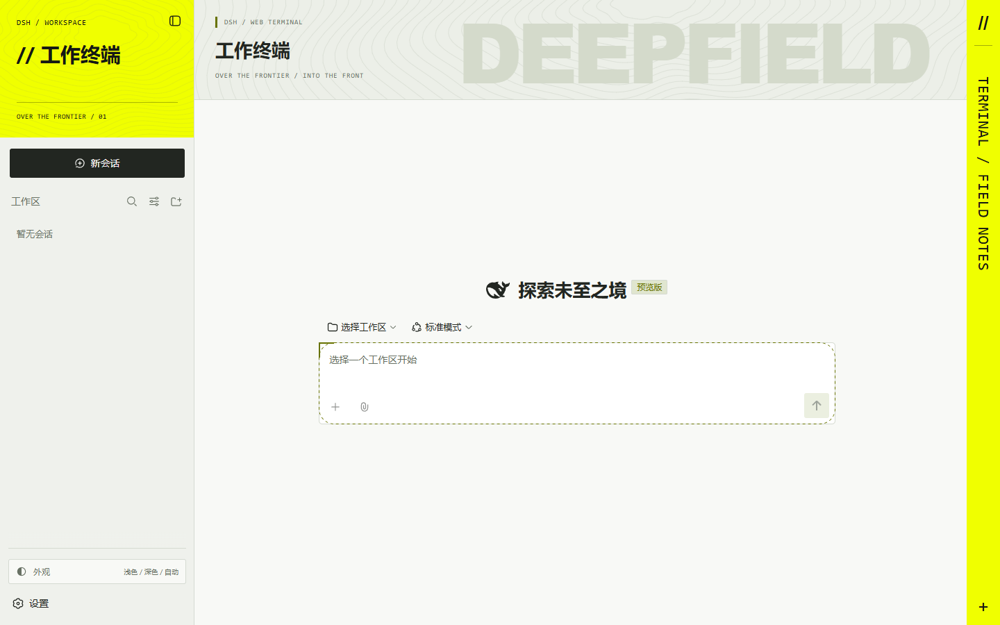
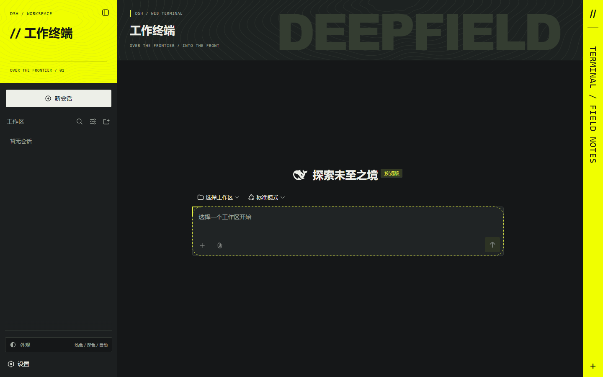

# dsh-theme-endfield-style

[English](README.md) | 中文

仿《明日方舟：终末地》风格的 [DeepSeek Harness](https://github.com/deepseek-ai/deepseek-harness) 网页端主题。
非官方同人作品，与游戏发行方无关。

| 浅色 | 深色 |
|---|---|
|  |  |

## 改了什么

- 荧光黄侧栏顶部，以及右侧边缘的竖向信号条。
- 页眉带有超大的 `DEEPFIELD` 背景字，和用代码绘制的等高线纹理。
- 工程灰白 / 石墨黑两套配色，跟随 DSH 自带的浅色 / 深色 / 跟随系统设置。
- 小圆角、细线条，侧栏里多一个跳转到自带「外观」设置的快捷入口。

所有图形都由代码生成：没有取自游戏的图片文件，没有网络请求，也没有持续动画。

## 安装

```sh
dsh plugin --profile web add dsh-theme-endfield-style
```

也可以在 [dsh-market](https://github.com/dsh-market/dsh-market) 的「主题」页安装。安装后刷新页面即可。

如果 npm 上还没有这个包，可以直接从 GitHub 安装：

```sh
dsh plugin --profile web add github:Xiaoli-Asuna/dsh-theme-endfield-style
```

## 卸载

```sh
dsh plugin --profile web remove dsh-theme-endfield-style
```

主题只会添加一个 `<style>` 标签、几个装饰元素，以及 `<html>` 上的 `data-endfield-theme` 属性。卸载插件后这些都会被移除。

## 兼容性

样式选择器使用 DSH 带哈希的组件类名（例如 `.hHd-Xa_root`），已在 DSH `0.1.5-rc.3` 上验证。DSH 升级后类名可能改变，主题的部分样式可能失效，需要更新选择器。遇到这种情况，请带上你的 DSH 版本提 issue。

## 构建

```sh
npm install
npm run build   # 由 src/client.ts 和 src/styles.css 重新生成 lib/client.js
```

## 许可证

MIT。本主题是视觉上的致敬；《明日方舟：终末地》等名称归其各自权利人所有。